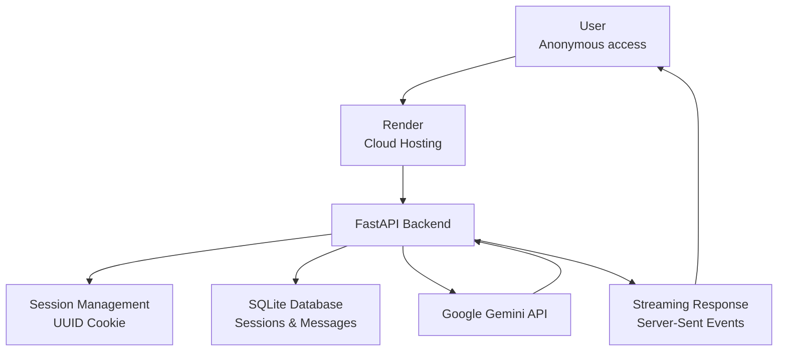

# Chatbot MVP

### AI Conversations Without the Login Barrier

A lightweight, AI-powered chatbot built with **Python, FastAPI, SQLite, and Google Gemini API**, designed to make AI conversations accessible without requiring users to create an account or log in.

The project explores a simple idea: users should be able to start an AI conversation without going through an account registration process, while privacy remains an important design consideration.

<p align="center">
  <a href="https://chatbot-mvp-r2yg.onrender.com/">
    <strong>🚀 Try the Live Application</strong>
  </a>
</p>

---

## 🌐 Live Demo

**Application:** https://chatbot-mvp-r2yg.onrender.com/

**GitHub Repository:** https://github.com/HarishrajaK04/chatbot-mvp

---

## 📌 Project Overview

Chatbot MVP is a web-based conversational AI application that allows users to interact with Google's Gemini language model through a minimal chat interface.

Unlike conventional applications that require account creation, this prototype allows users to start chatting without registration.

The application uses anonymous browser sessions to associate conversations with individual visitors without requiring personally identifiable account information.

The primary motivation behind this project is to explore accessible AI interaction with a privacy-conscious design approach.

## ✨ Key Features

- **No Login Required:** Start chatting without creating an account.
- **Anonymous Sessions:** Each visitor receives a randomly generated session ID.
- **AI-Powered Responses:** Uses Google Gemini to generate conversational responses.
- **Streaming Responses:** Displays AI responses progressively using Server-Sent Events (SSE).
- **Conversation History:** Retrieves previous messages associated with the current browser session.
- **New Chat:** Start a fresh conversation with a new anonymous session.
- **Minimal Interface:** Clean and straightforward chat experience.
- **Cloud Deployment:** Hosted on Render for public access.

## 🛠️ Technology Stack

| Technology | Purpose |
|---|---|
| Python | Core programming language |
| FastAPI | Backend framework and API development |
| SQLite | Conversation and session storage |
| Google Gemini API | AI response generation |
| HTML | Frontend structure |
| CSS | Interface styling |
| JavaScript | Chat interactions and streaming |
| Server-Sent Events | Streaming AI responses |
| Render | Cloud hosting and deployment |
| Git & GitHub | Version control and source management |

## 🏗️ System Architecture

The application follows a simple client-server architecture.



### How It Works

1. A user opens the application without creating an account.
2. FastAPI creates an anonymous session using a randomly generated UUID.
3. The session ID is stored in an HTTP-only browser cookie.
4. User messages are associated with that session in SQLite.
5. The backend retrieves the conversation history.
6. The conversation is sent to the Google Gemini API.
7. Gemini generates a response.
8. FastAPI streams the response back to the frontend using Server-Sent Events.
9. The assistant response is stored in the conversation history.

## 🔐 Privacy Approach

Privacy is an important design consideration behind this project.

Current implementation:

- No user registration or login system.
- No account profile required to start chatting.
- Anonymous session identifiers generated using UUIDs.
- HTTP-only session cookies.
- Conversations are separated using session identifiers.

**Important privacy considerations:**

This is an early-stage prototype, not a guarantee of complete or 100% privacy.

- Conversation messages are currently stored in the SQLite database.
- User prompts and conversation history are sent to Google Gemini to generate responses.
- The application does not currently provide automatic conversation deletion or a defined data-retention policy.
- Hosting and third-party AI providers may process information according to their respective policies.

Avoid submitting passwords, financial information, personal identifiers, or other sensitive information.

## 📂 Project Structure

```text
chatbot-mvp/
│
├── chatbot-mv/
│   │
│   ├── backend/
│   │   ├── main.py
│   │   ├── database.py
│   │   └── requirements.txt
│   │
│   └── frontend/
│       ├── index.html
│       ├── style.css
│       └── app.js
│
└── README.md
```

The SQLite database is created by the application at runtime and should not be committed to the repository.

## ⚙️ Run Locally

### Prerequisites

- Python 3.10 or later
- Google Gemini API key
- Git

### 1. Clone the repository

```bash
git clone https://github.com/HarishrajaK04/chatbot-mvp.git
```

### 2. Navigate to the backend directory

```bash
cd chatbot-mvp/chatbot-mv/backend
```

### 3. Create a virtual environment

```bash
python -m venv venv
```

Activate it:

**Windows:**

```bash
venv\Scripts\activate
```

**macOS / Linux:**

```bash
source venv/bin/activate
```

### 4. Install dependencies

```bash
pip install -r requirements.txt
```

### 5. Configure the Gemini API key

Get your API key from Google AI Studio:

https://aistudio.google.com/

Set the environment variable.

**Windows PowerShell:**

```powershell
$env:GEMINI_API_KEY="YOUR_API_KEY"
```

**macOS / Linux:**

```bash
export GEMINI_API_KEY="YOUR_API_KEY"
```

Never commit your API key or expose it in frontend code.

### 6. Start the application

```bash
uvicorn main:app --reload
```

### 7. Open the application

Visit:

```text
http://127.0.0.1:8000
```

You can now start a conversation with the chatbot.

## 🔌 API Endpoints

| Method | Endpoint | Description |
|---|---|---|
| GET | `/` | Serves the chatbot interface |
| GET | `/api/history` | Retrieves current session history |
| POST | `/api/chat` | Sends a message and streams an AI response |
| POST | `/api/new-chat` | Creates a new anonymous conversation |

### Example Chat Request

```json
{
  "message": "What is Machine Learning?"
}
```

The `/api/chat` endpoint returns a streaming response using Server-Sent Events.

## ☁️ Deployment

The application is deployed using **Render**.

Deployment configuration:

- Root Directory: `chatbot-mv/backend`
- Build Command:

```bash
pip install -r requirements.txt
```

- Start Command:

```bash
uvicorn main:app --host 0.0.0.0 --port $PORT
```

- Environment Variable:

```text
GEMINI_API_KEY=your_api_key
```

**Deployment note:** SQLite uses a local file. For reliable persistence across Render restarts and deployments, configure an appropriate persistent disk or migrate to a managed database.

## 🚧 Future Improvements

Some areas I would like to explore in future iterations:

- Stronger privacy controls and transparent data handling.
- Conversation deletion and configurable data retention.
- Improved session lifecycle management.
- Better error handling and API reliability.
- Rate limiting and abuse prevention.
- Responsive interface improvements.
- More comprehensive testing.
- Production-ready database and deployment architecture.

## 🎯 Learning Outcomes

Building this project helped me gain practical experience in:

- Developing backend applications using FastAPI.
- Integrating Large Language Models through the Gemini API.
- Implementing anonymous session management.
- Working with SQLite and relational data storage.
- Building interactive frontend applications.
- Implementing real-time streaming responses.
- Deploying Python applications using Render.

## 👨‍💻 Author

**Harish Raja**

Aspiring AI/ML Developer | Python | Machine Learning | Generative AI

- GitHub: https://github.com/HarishrajaK04
- Project Demo: https://chatbot-mvp-r2yg.onrender.com/

---

*Chatbot MVP is an independent learning project focused on exploring Generative AI application development and login-free conversational experiences.*

